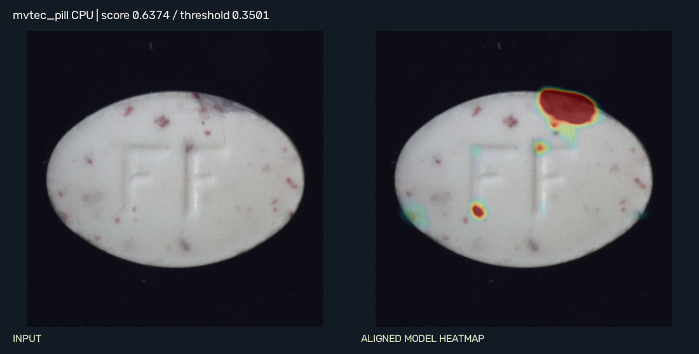
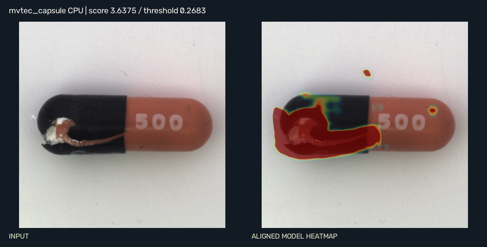
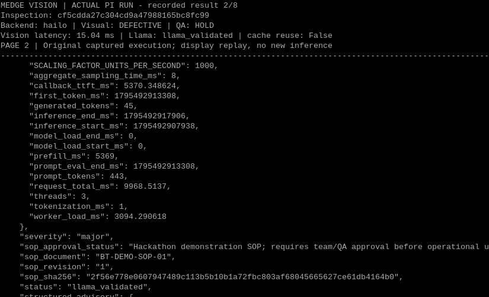
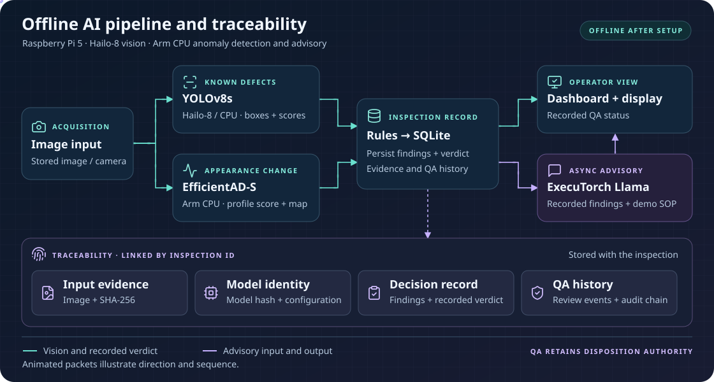
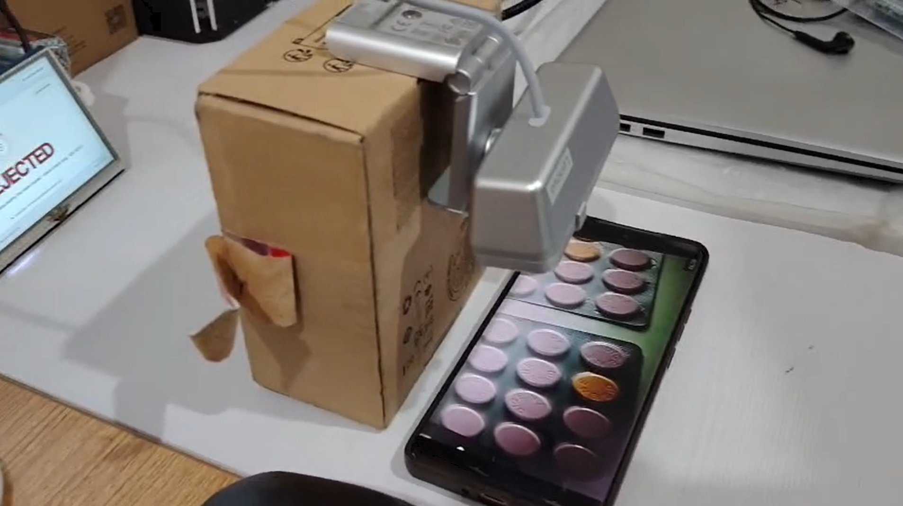
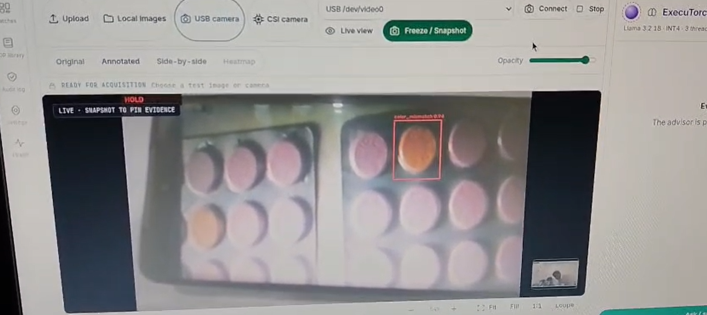

# Medge Vision

[](https://github.com/Haridharan-D/arm-hailo-medgevision-llama-executorch/actions/workflows/tests.yml?query=branch%3Amain)

An offline inspection station for pharmaceutical blister packs on Raspberry Pi 5. Hailo-8 finds known defects, Arm CPU anomaly models highlight unusual appearances, and ExecuTorch Llama explains recorded findings while QA retains the verdict.

Built for the **Bharat AI-SoC Challenge 2026–27 (PS5)** by Haridharan D (team lead), Priyadharsan D and Jayaraj M.

**[Final report for judging (PDF)](docs/Final_MedgeVision_Report.pdf)** · [Judges' guide](docs/JUDGES_START_HERE.md) · [Run it](docs/QUICKSTART.md) · [Full results](docs/RESULTS.md)

---

## See the models run

| YOLOv8s crack detection | MVTec pill heatmap |
| :---: | :---: |
| [](evidence/judging/yolo_crack_boxes.png) | [](evidence/judging/mvtec_pill_heatmap.png) |
| Crack confidence **93.53%** | Score **0.6374**, threshold **0.3501** |
| **MVTec capsule heatmap** | **VisA capsules heatmap** |
| [](evidence/judging/mvtec_capsule_heatmap.png) | [](evidence/judging/visa_capsules_heatmap.png) |
| Score **3.6375**, threshold **0.2683** | Score **2.2623**, threshold **0.2028** |

Fresh CPU inference on selected examples using the shipped ONNX models. VisA remains a research profile with **24% held-out recall**. [Inference receipt](evidence/judging/inference_receipt.json) · [All examples and plots](evidence/judging/README.md)

---

## ExecuTorch Llama proof

| Dashboard advisory | Pi terminal replay |
| --- | --- |
| [](evidence/judging/llama_advisory_proof.png) | [](evidence/gallery/terminal/terminal_case_02_02.png) |

Same recorded Pi case · **BT-02** · `llama_validated` · **443 prompt / 45 generated tokens** · **9.970 s** · zero cache reuse. [Original run record](evidence/target_20261124/eight_test_report.json)

| Spec | Deployed setting |
| --- | --- |
| Model | **Llama 3.2 1B Instruct**, SpinQuant INT4 EO8 · **1.136 GB** |
| Runtime | **ExecuTorch 1.0.0 + XNNPACK** on Pi 5 Arm CPU · **3 threads** by default |
| Tokens | **2,048** context · **1,536** prompt budget · **128** output cap |

The exported graph contains **180 XNNPACK delegate calls**. [Runtime and graph details](docs/LLAMA_EXECUTORCH_OPTIMIZATION.md#graphbuild-evidence)

---

## What it does

- **Inspect stored images or USB/CSI camera captures.** YOLOv8s marks seven defect classes. Three EfficientAD-S profiles produce category-specific scores and heatmaps.
- **Record the verdict before asking Llama.** Advisory runs asynchronously against the recorded findings and demo SOP. It cannot alter the verdict.
- **Keep a traceable QA record.** Images, model and configuration hashes, and append-only reviews stay tied to the inspection ID. Use the dashboard, verdict-only display or terminal tools.

---

## Engineering scorecard

**Target hardware:** Raspberry Pi 5 · BCM2712 / Cortex-A76 · aarch64 Debian Trixie · Hailo-8.

| Engineering check | Measured result or setting | Test basis or source |
| --- | --- | --- |
| Detector speed | **580.115 → 15.197 ms** mean · **38.17×** ratio | Pi CPU → Hailo-8 |
| Detector tail latency | **15.526 ms p95** · **15.635 ms p99** | Hailo-8 detector path |
| Detector process memory | **254.07 → 206.43 MiB** mean RSS | Pi CPU → Hailo-8 |
| Detector model size | **44.74 → 10.11 MB** · **77.41% smaller** | FP32 ONNX → INT8 HEF |
| **YOLO vision quantization** | **INT8 post-training quantization** · Hailo-8 HEF · uint8 RGB input | Hailo DFC **3.34.0** · **512** training-only calibration images available. [Compile recipe](reproduction/hailo/compile_hef.sh) |
| YOLO localization | **99.22% mAP50** · **89.19% mAP50–95** | FP32 holdout · 1,303 images / 2,956 boxes |
| YOLO operating point | **97.63% micro F1** | Frozen class thresholds · 0.86–0.91 |
| INT8 output agreement | **96.10% agreement F1** · **37 matched**, **2 INT8-only**, **1 FP32-only** | Derived from FP32 reference matching · 18 unlabeled images |
| **EfficientAD-S vision precision** | **FP32 ONNX** on Arm CPU · no INT8 conversion applied | [Anomaly model contracts](docs/MODEL_CARDS.md) |
| MVTec pill | **92.37% F1** · **0.9834 AUROC** · **0.9557 AUPRO** | EfficientAD-S holdout |
| MVTec capsule | **88.32% F1** · **0.9485 AUROC** · **0.8308 AUPRO** | EfficientAD-S holdout |
| VisA capsules | **38.40% F1** · **0.6502 AUROC** · **0.6985 AUPRO** | EfficientAD-S holdout |
| **Llama quantization** | **SpinQuant INT4 EO8** · 4-bit weights / dynamic 8-bit activations · group size **32** · 8-bit embeddings and 8-bit output projection | Upstream Llama 3.2 1B Instruct PTE · `8da4w_output_8da8w`. [Export settings](docs/LLAMA_EXECUTORCH_OPTIMIZATION.md) |
| Llama advisory latency | **15.156 → 8.071 s** median · **10.233 s** adaptive p95 | 1B INT4 baseline → adaptive-v1 |
| Llama decode and guard replay | **12.003 tokens/s** median · **26/39 → 36/39** accepted | Historical advisory scenarios |
| Station demonstration | **8/8** expected visual outcomes · **8/8** validated replies · **8.967 s** median advisory | Selected Pi cases · zero cache reuse |
| **Live USB capture configuration** | **MJPG · 1280 × 720 · 30 fps · 1-frame buffer** | Requested OpenCV settings. [Camera implementation](app/camera.py) |
| **Live USB frame budget** | **18.14 ms/frame** available for capture and output work at **30 FPS** | Calculated as **33.33 ms** target period minus **15.197 ms** mean Hailo detector time. |
| **Live USB throughput scenario** | **24.9–30 FPS** projected | Assumes **15–25 ms** of capture, encoding and other work per frame in addition to measured mean detector time. Capped at **30 FPS** by the camera loop. |
| **USB snapshot** | Waits up to **2 s** for a frame captured after the request | Freeze / Snapshot uses the fresh-frame gate. [Camera implementation](app/camera.py) |

Detector timing uses repeated stored images (35 CPU and 3,948 Hailo calls). AUPRO integrates to pixel FPR 0.30. The camera projection uses an assumed overhead range to show sensitivity. [Full benchmark evidence and measurement coverage](docs/RESULTS.md) · [Model parameters](docs/MODEL_CARDS.md)

---

## Run it

From a clone with a Python 3.11 virtual environment active, run CPU vision on Windows or Linux.

```sh
python -m pip install -r requirements.txt pytest httpx
python tools/verify_repository_artifacts.py
python tools/configure_station.py --backend onnx
python main.py --desktop
```

Open **http://127.0.0.1:8765/**. The verifier checks the included vision files and prepares the bundled Arm advisory runtime. The Pi uses the bundled Hailo-8 HEF and separately provisioned Llama artifacts. [Model files](models/README.md) · [Full setup and Pi deployment](docs/QUICKSTART.md)

---

## Architecture

[](docs/architecture.svg)

The teal path records vision results and the QA verdict. The violet path reads recorded findings and returns advisory text to the operator. The traceability panel shows what stays tied to each inspection ID. [Static architecture](docs/architecture.svg) · [Audit and records](docs/DATABASE_AND_AUDIT.md) · [Training and conversion](docs/MODEL_LIFECYCLE.md)

### Live USB camera

| Bench setup | Live dashboard result |
| :---: | :---: |
| [](evidence/judging/usb_camera_setup.png) | [](evidence/judging/usb_camera_live_detection.png) |

The camera viewed a blister-pack sample displayed on a phone. The live dashboard for `/dev/video0` shows a **color mismatch** box and **HOLD**. This bench demonstration verifies acquisition and visual output for the pictured input.

---

## Validation and limits

- **100 regression tests passed** in the local software run. Earlier release checks include CPU model smoke tests, native JSON-boundary checks and verified portable restore. [Tests](tests/) · [CI workflow](.github/workflows/tests.yml) · [Acceptance report](docs/SUBMISSION_REPORT.md)
- **Use the right comparison.** The FP32 holdout contains 1,303 defect images. The separate 18-image quantization experiment measures agreement with FP32 outputs. The USB photos cover a selected bench demonstration. [Evaluation scope and paired test procedure](docs/AUTOVI_COMPARISON.md)
- **VisA missed 76 of 100 anomalies** and remains a research profile. Advisory is informational, and authorized QA retains release authority. [Limitations](docs/SUBMISSION_LIMITATIONS.md)

[Documentation index and earlier reports](docs/README.md) · [Third-party terms](docs/THIRD_PARTY_NOTICES.md)
