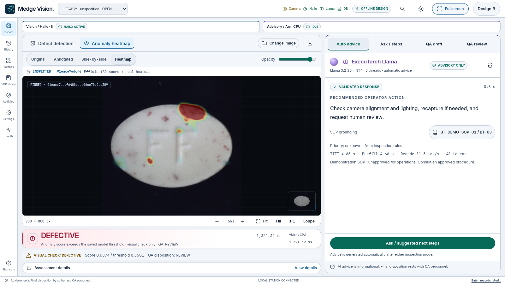

# Medge Vision

Offline optical inspection for pharmaceutical blister packs on Raspberry Pi 5. Hailo-8 localizes known defects, Arm CPU anomaly models highlight unusual appearances, and ExecuTorch Llama provides advice on recorded findings. All inference runs locally after setup.

Built for the **Bharat AI-SoC Challenge 2026–27 (PS5)** by Haridharan D (team lead), Priyadharsan D and Jayaraj M.

**[Judges start here](JUDGES_START_HERE.md)** · [Technical paper (PDF)](docs/MEDGE_VISION_PS5_Research_Paper.pdf) · [Run it](QUICKSTART.md) · [Full results](docs/RESULTS.md)

| Known-defect inspection | Anomaly inspection |
| :---: | :---: |
| [](evidence/gallery/dashboard/02_yolo_defective.png) | [](evidence/gallery/dashboard/04_anomaly_defective.png) |
| YOLOv8s on Hailo-8 | EfficientAD-S on Arm CPU |

Actual Raspberry Pi captures. [See all eight cases and their saved outputs](evidence/gallery/README.md).

## What it does

- **Inspect stored images or USB/CSI camera captures.** YOLOv8s marks seven defect classes. Three EfficientAD-S profiles produce category-specific scores and heatmaps.
- **Record the verdict before asking Llama.** Advisory runs asynchronously against the recorded findings and demo SOP. It cannot alter the verdict.
- **Keep a traceable QA record.** Images, model and configuration hashes, and append-only reviews stay tied to the inspection ID. Use the dashboard, verdict-only display or terminal tools.

## Measured performance

| Check | Recorded result | Scope |
| --- | --- | --- |
| Detector latency | **580.115 → 15.197 ms mean** (38.17×); Hailo p95 **15.526 ms** | Pi 5 CPU vs Hailo-8, repeated stored images, detector path |
| Detector file size | **44.74 → 10.11 MB** (77.41% smaller) | FP32 ONNX vs INT8 HEF, standalone detector |
| Known-defect accuracy | **89.19% mAP50–95**, **99.22% mAP50** | Original FP32 holdout, 1,303 images and 2,956 labeled boxes |
| Anomaly image F1 | **92.37%** pill, **88.32%** capsule, **38.40%** VisA | Separate category holdouts at frozen thresholds |
| Advisory optimization | **15.156 → 8.071 s** median, **26/39 → 36/39** final guard acceptance | Historical 1B baseline vs adaptive-v1 on the same scenario protocol |
| Integrated station | **8/8** expected visual outcomes, **8/8** fresh validated replies | Selected Pi cases, zero cache reuse, 8.967 s median advisory |

[Detailed results and denominators](docs/RESULTS.md) · [Raw evidence](docs/EVIDENCE_GUIDE.md) · [AutoVI benchmark context](docs/AUTOVI_COMPARISON.md)

## Run it

From a clone with a Python 3.11 virtual environment active, run CPU vision on Windows or Linux.

```sh
python -m pip install -r requirements.txt pytest httpx
python tools/verify_repository_artifacts.py
python tools/configure_station.py --backend onnx
python main.py --desktop
```

Open **http://127.0.0.1:8765/**. The verifier checks the included vision files and prepares the bundled Arm advisory runtime. The Pi uses the bundled Hailo-8 HEF and separately provisioned Llama artifacts. [Model files](models/README.md) · [Full setup and Pi deployment](QUICKSTART.md)

## Architecture

```text
Image or camera frame → YOLOv8s (Hailo-8 / CPU) or EfficientAD-S (CPU)
                     → inspection rules → SQLite → dashboard + verdict display

Recorded inspection + demo SOP → ExecuTorch Llama → guarded advisory
```

[Architecture diagram](docs/architecture.svg) · [Model cards](docs/MODEL_CARDS.md) · [Training and conversion](docs/MODEL_LIFECYCLE.md)

## Validation and limits

- **100 regression tests passed** in the local software run. Earlier release checks include CPU model smoke tests, native JSON-boundary checks and verified portable restore. [Tests](tests/) · [CI workflow](.github/workflows/tests.yml) · [Acceptance report](SUBMISSION_REPORT.md)
- **Labeled INT8 accuracy change, healthy-only YOLO specificity and production-camera generalization remain unmeasured.** The 18-image FP32/INT8 experiment measures output agreement. [Quantization evidence and paired test procedure](docs/AUTOVI_COMPARISON.md)
- **VisA missed 76 of 100 anomalies** and remains a research profile. Advisory is informational, and authorized QA retains release authority. [Limitations](docs/SUBMISSION_LIMITATIONS.md)

[Documentation index](docs/README.md) · [Engineering upgrade PDF](docs/MEDGE_VISION_PS5_Engineering_Upgrade_Report.pdf) · [Original project PDF](docs/MEDGE_VISION_Final_Project_Report.pdf) · [Third-party terms](THIRD_PARTY_NOTICES.md)
