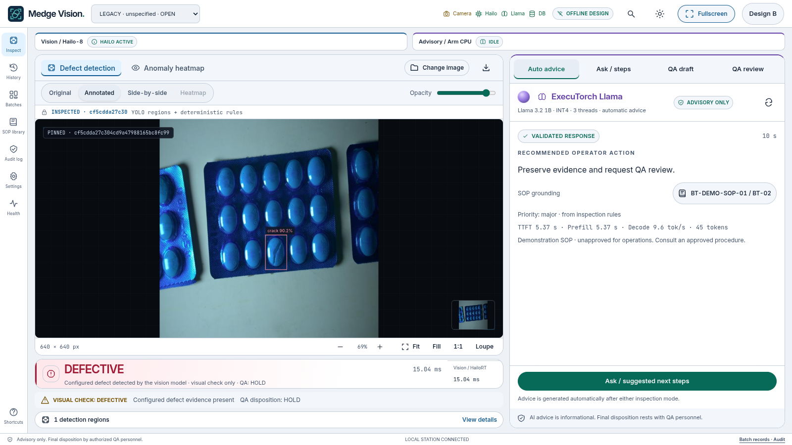
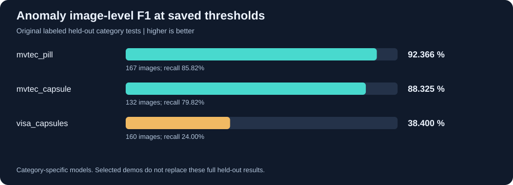
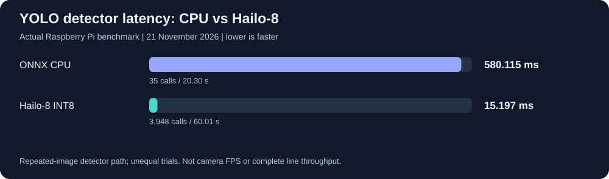
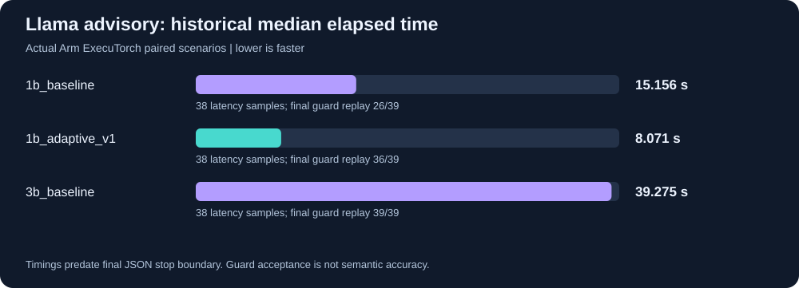
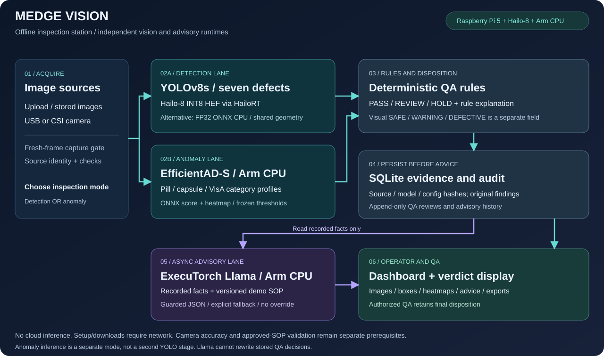

<p align="center"><a href="JUDGES_START_HERE.md"><strong>JUDGES START HERE</strong></a> / <a href="QUICKSTART.md">RUN THE PROJECT</a> / <a href="docs/RESULTS.md">MEASURED RESULTS</a> / <a href="evidence/gallery/README.md">REAL OUTPUTS</a></p>

### One station. Three local inference paths. Evidence you can inspect.

> **26 November engineering update:** [PS5 engineering report (PDF)](docs/MEDGE_VISION_PS5_Engineering_Upgrade_Report.pdf) · [Audit, data and reproduction commands](docs/ENGINEERING_UPGRADE_20261126.md). The release passed 95 regression tests and matched detection outputs in all 12 paired CPU checks.

| Understand the engineering | Inspect the evidence | Reproduce the system |
| :--- | :--- | :--- |
| [Architecture](docs/architecture.svg) | [Actual Pi screenshots](evidence/gallery/README.md) | [Install, verify and launch](QUICKSTART.md) |
| [Training and deployment model cards](docs/MODEL_CARDS.md) | [F1, latency and quantization](docs/RESULTS.md) | [Artifacts and recovery](docs/STORAGE_AND_RECOVERY.md) |
| [Acceptance and limitations](SUBMISSION_REPORT.md) | [Metrics and source hashes](evidence/metrics/README.md) | [Measurement and rerun guide](docs/EVIDENCE_GUIDE.md) |

<details>
<summary><strong>The project in 60 seconds</strong></summary>

- **Problem:** bring pharmaceutical visual inspection evidence to the workstation without cloud inference.
- **Implementation:** seven-class Hailo detection, three independent Arm anomaly profiles, and bounded on-device Llama advice.
- **Demonstrated integration:** eight selected Pi cases with recorded visual outcomes and fresh validated advisory responses. This demonstrates functionality, not population accuracy.
- **Distinctive engineering:** separate vision/advisory execution, SOP citations, preserved evidence, append-only QA reviews and model verification.
- **Limits:** the VisA profile is weak; ground-truth INT8 accuracy loss and production endurance remain unmeasured. Results below preserve those boundaries.

</details>


> **Judges: [start here for a three-minute evidence walkthrough](JUDGES_START_HERE.md).** Architecture, actual Pi outputs, full metrics, report and reproduction checks are linked in one place.

---

Medge Vision is a local workstation for tablet, capsule and blister-pack inspection. A custom seven-class **YOLOv8s** detector runs on **Hailo-8**. Three independent **EfficientAD-S** profiles produce anomaly scores and heatmaps on the **Raspberry Pi CPU**. **Llama 3.2 1B Instruct**, running locally through **ExecuTorch**, provides asynchronous SOP-linked advice about the recorded findings.

Models, the dashboard, SQLite history and advisory run offline after provisioning. **Vision and advice are separate pipelines. Llama cannot change the detector/QA decision.**

> **Release scope:** a measured research demonstrator with preserved artifacts, tests and recovery data. Visual **SAFE** means the configured model check is clear; it is not pharmaceutical safety certification or QA release approval. Unvalidated product profiles retain QA **REVIEW** even when the visual check is clear.

## See the workstation, then inspect the evidence

| Hailo defect localization + Llama | Arm anomaly heatmap + Llama |
| :---: | :---: |
| [](evidence/gallery/dashboard/02_yolo_defective.png) | [](evidence/gallery/dashboard/04_anomaly_defective.png) |
| Recorded crack detection; QA **HOLD** | Recorded appearance deviation; QA **REVIEW** |

Actual Pi Chromium captures displaying saved, measured inspections. Click to inspect at full size. The [47-screenshot gallery](evidence/gallery/README.md) connects images to inspection IDs, raw outputs, heatmaps and advice. Terminal screenshots are explicitly labelled recorded-output replay.

### Four numbers, four explicit scopes

| **99.22% mAP50** | **15.197 ms** | **8.071 s** | **8/8 selected cases** |
| :--- | :--- | :--- | :--- |
| Original YOLO FP32 held-out test | Historical Hailo detector-path mean | Historical adaptive-v1 advisory median | Actual complete-station integration |
| 1,303 images / 2,956 defect boxes | CPU mean 580.115 ms; derived **38.17x** ratio | Baseline 15.156 s; final guard replay **36/39** | Eight fresh validated responses; zero cache reuse |
| No healthy-only test images | Repeated-image trials, not camera FPS | Guard acceptance is not semantic accuracy | Selected demonstration, not population accuracy |

[Full measurements and denominators](docs/RESULTS.md) · [Source-linked CSV/JSON](evidence/metrics/README.md) · [Engineering decisions and tradeoffs](docs/ENGINEERING_DECISIONS.md)

## What makes Medge Vision distinctive



- **Specialized visual paths:** known-defect localization on Hailo and category-specific anomaly maps on Arm, with independent model contracts and evaluation.
- **Advice without decision authority:** the native ExecuTorch assistant receives a pinned inspection and bounded SOP context. It cannot turn a stored HOLD into PASS.
- **Reviewable evidence:** original images, model/configuration identity, detections, native advisory statistics and QA history stay linked to the inspection.
- **A workstation, not just a notebook:** offline dashboard, local-image and camera input, terminal inspection, dual-display verdict view and portable evidence restore.
- **An inspectable engineering record:** source-linked metrics, preserved weak results, regression checks and explicit unmeasured limits.

The diagrams animate only for presentation; they are not live hardware indicators. Reduced-motion preferences disable their animation.

## Project navigation

| Guide | Contents |
| --- | --- |
| [Quick start](QUICKSTART.md) | Clone, install, verify models, configure CPU/Hailo, test and launch |
| [Full results and benchmarks](docs/RESULTS.md) | Per-class F1/mAP, confusion matrices, CPU/Hailo and Llama comparisons |
| [Evidence guide](docs/EVIDENCE_GUIDE.md) | Where each metric was measured, source JSON pointers and rerun commands |
| [Deployment model cards](docs/MODEL_CARDS.md) | Training, preprocessing, conversion, inputs/outputs and limitations |
| [Machine-readable metrics](evidence/metrics/README.md) | Eight CSVs, full-precision JSON, source hashes and formulas |
| [Actual Pi screenshot gallery](evidence/gallery/README.md) | 47 terminal/dashboard screenshots, inspection results and advice |
| [Engineering acceptance report](SUBMISSION_REPORT.md) | Executed target checks and explicit PASS / NOT TESTED boundaries |
| [Final project report — PDF](docs/MEDGE_VISION_Final_Project_Report.pdf) | Methodology, results, hardware utilization and optimization |
| [Portable backup and restore](backups/README.md) | Eight measured inspections, images, heatmaps and stored advice |

## Verified release evidence

| Check | Recorded outcome | Evidence |
| --- | --- | --- |
| Actual Pi 5 + Hailo-8 execution | **PASS** | [24 November records](evidence/target_20261124/eight_test_report.json) |
| Two selected cases per visual pipeline | **8/8 outcomes matched** | [Run summary](evidence/target_20261124/summary.json) |
| Actual Arm ExecuTorch advisory | **8/8 fresh `llama_validated`**, zero cache reuse | [Original responses and native statistics](evidence/target_20261124/eight_test_report.json) |
| Python regression suite at evidence release | **76 passed** on Pi and laptop | [Pi log](evidence/gallery/target_regression_with_restore.txt) · [Laptop log](evidence/gallery/regression_with_restore.txt) |
| Native JSON generation boundary | **PASS**, five C++ cases | [Test source](tests/json_boundary_test.cpp) |
| Portable recovery through the actual app | **PASS** | [Restored API verification](evidence/gallery/restored_api_verification.json) |
| New-camera accuracy / long-shift endurance | **NOT TESTED** | [Limitations](docs/SUBMISSION_LIMITATIONS.md) |

Eight selected cases establish functional integration, not 100% model accuracy. Historical accuracy, timing experiments and final demonstrations are kept separate below.

## Model accuracy

### YOLOv8s: seven-class defect detection

The original curated FP32 held-out test contains **1,303 images and 2,956 annotated defect instances**.

| Metric | Result | Measurement scope |
| --- | --- | --- |
| Precision | **99.46%** | Original evaluator aggregate |
| Recall | **99.26%** | Original evaluator aggregate |
| mAP at IoU 0.50 | **99.22%** | Original evaluator AP sweep |
| mAP at IoU 0.50–0.95 | **89.19%** | Original evaluator AP sweep |
| Micro precision | **97.83%** | Frozen class thresholds; summed recorded counts |
| Micro recall | **97.43%** | Frozen class thresholds; summed recorded counts |
| **Micro F1** | **97.63%** | **Derived** from 2,880 TP / 64 FP / 76 FN |

`F1 = 2TP / (2TP + FP + FN)`. Evaluator and frozen-threshold metrics have different operating points; they must not be merged into one claimed score. [All seven classes: precision, recall, F1, F2, mAP and counts](docs/RESULTS.md#1-yolov8s-original-fp32-held-out-evaluator) · [Original JSON](evidence/historical/test_metrics.json).

**Dataset boundary:** there are **no normal-only test images**, so healthy-image specificity and false-reject rate were not established. Source-family/perceptual grouping does not prove independence of physical strips.

### EfficientAD-S: category anomaly detection

Three independently trained category models; each completed **70,000 FP32 steps**, batch size 1, using normal training images. These are the original full held-out results at saved thresholds, not selected demo scores.

| Profile | Test images | Precision | Recall | **Image F1** | Image AUROC | Pixel F1 / Dice |
| --- | --- | --- | --- | --- | --- | --- |
| MVTec pill | 167 | 100.00% | 85.82% | **92.37%** | 0.9834 | 69.26% |
| MVTec capsule | 132 | 98.86% | 79.82% | **88.32%** | 0.9485 | 40.29% |
| VisA capsules | 160 | 96.00% | 24.00% | **38.40%** | 0.6502 | 37.08% |

**VisA is a weak research profile:** 76/100 anomalous images were missed at its saved threshold. High pixel AUROC does not imply strong image-level detection. EfficientAD is not EfficientNet and runs on CPU, separately from the YOLO HEF.

[Confusion matrices, AUPR, specificity, false alarms and pixel AUPRO](docs/RESULTS.md#3-efficientad-s-labeled-image-level-results) · [Original anomaly results](evidence/historical/METRICS.json) · [Full-precision CSV](evidence/metrics/anomaly_image.csv).



## CPU versus Hailo: actual target measurements

Actual **21 November Raspberry Pi** repeated-image detector benchmark:

| Backend | Calls | Mean latency | P95 latency | Throughput* | Mean RSS |
| --- | --- | --- | --- | --- | --- |
| ONNX Runtime CPU | 35 | 580.115 ms | 580.855 ms | 1.724 calls/s | 254.07 MiB |
| Hailo-8 INT8 | 3,948 | 15.197 ms | 15.526 ms | 65.789 calls/s | 206.43 MiB |

**38.17× mean detector-path latency ratio.** Trials have different sample counts/durations and use unannotated training-source demo images. *Throughput is repeated detector calls/s, not live-camera FPS, full inspection-plus-advice throughput or production-line capacity.*



[CPU, RAM, temperature, P99 and sampling scope](docs/RESULTS.md#5-actual-pi-detector-benchmark-cpu-versus-hailo-8) · [Original benchmark](evidence/historical/METRICS.json) · [Comparison CSV](evidence/metrics/cpu_vs_hailo.csv).

### Export and quantization: before versus after

| Stage | Measured evidence | Interpretation |
| --- | --- | --- |
| FP32 ONNX export | Eight-image raw-tensor parity passed; opset 11; `[1,11,8400]` output | Export check, not accuracy delta |
| INT8 HEF deployment | Actual Hailo-8 load/inference passed | Target execution verified |
| FP32/INT8 reference comparison | 18 images; 37 matched, two INT8-only and one FP32-only detection | Agreement precision 94.87%, recall 97.37%; **unannotated** |
| Labeled quantized mAP/F1 delta | **NOT TESTED** | No post-quantization accuracy prediction substituted |

Reference agreement is not ground-truth defect precision/recall. [Export evidence](evidence/historical/export_status.json) · [Conversion and preprocessing](docs/MODEL_LIFECYCLE.md) · [Complete interpretation](docs/RESULTS.md#6-quantization-and-export-what-was-verified).

## Llama: candidate comparison and optimization

The historical paired experiment uses 50 scenarios: 39 bounded advisory cases and 11 invalid inputs. Latency/TTFT summaries contain 38 samples; decode summaries contain 39. Acceptance means automated guard acceptance, **not expert recommendation accuracy**.

| Candidate | Median elapsed | Median callback TTFT | Median decode rate | Peak RSS | Final guard replay |
| --- | --- | --- | --- | --- | --- |
| 1B baseline | 15.156 s | 8.136 s | 10.264 tokens/s | Not recorded | 26/39 |
| **1B adaptive-v1 — selected** | **8.071 s** | **4.010 s** | **12.003 tokens/s** | **1,598.55 MiB** | **36/39** |
| 3B baseline | 39.275 s | 21.220 s | 3.649 tokens/s | 3,223.77 MiB | 39/39 |

These timings predate the final native JSON stop boundary. Adaptive-v1 accepted 37/39 under experimental guards; final stricter replay accepted **36/39**. Historical timing is retained under its original scope.



The selected runtime keeps the existing 1B SpinQuant INT4 EO8 PTE and uses **three CPU threads**, **128 output tokens**, a **1,536-token prompt budget** and the artifact's actual **2,048-token context**. Persistent workers, bounded queues/cache and first-object JSON stopping reduce repeated work. Actual graph inspection found **180 XNNPACK delegate calls** and 490 remaining kernel calls; this is not per-kernel execution profiling.

The separate **24 November final-worker demonstration** returned eight fresh validated responses: median **8.9669 s**, range **7.5518–11.7278 s**. Full service-tree peak RSS was **1,977.06 MiB** and summed CPU **302.6%** (100% = one core). Regression/dependency work overlapped; these are not isolated Llama measurements.

[Native instrumentation and optimization](docs/LLAMA_EXECUTORCH_OPTIMIZATION.md) · [Original paired experiment](evidence/historical/BENCHMARKS.json) · [CSV](evidence/metrics/llama_comparison.csv).

## Actual model outputs

| Selected measured case | Visual check | QA | Measured observation | Actual screenshot |
| --- | --- | --- | --- | --- |
| YOLO clear | SAFE | REVIEW | No configured defect detected | [View](evidence/gallery/dashboard/01_yolo_safe.png) |
| YOLO crack | DEFECTIVE | HOLD | Confidence **0.90241**; vision **15.04 ms** | [View](evidence/gallery/dashboard/02_yolo_defective.png) |
| MVTec pill anomalous | DEFECTIVE | REVIEW | Score **0.637408** / threshold **0.350053** | [Heatmap + advice](evidence/gallery/dashboard/04_anomaly_defective.png) |
| MVTec capsule anomalous | DEFECTIVE | REVIEW | Score **3.637529** / threshold **0.268284** | [Heatmap + advice](evidence/gallery/dashboard/06_anomaly_defective.png) |
| VisA capsules anomalous | DEFECTIVE | REVIEW | Score **2.262270** / threshold **0.202819** | [Heatmap + advice](evidence/gallery/dashboard/08_anomaly_defective.png) |

Actual crack inspection, selected fields:

```json
{
  "inspection_id": "cf5cdda27c304cd9a47988165bc8fc99",
  "backend": "hailo",
  "decision": "HOLD",
  "severity": "major",
  "vision_ms": 15.04,
  "detections": [{
    "type": "crack",
    "class_id": 3,
    "confidence": 0.90241,
    "box_xyxy": [309.44, 339.16, 372.01, 440.55]
  }]
}
```

Its actual Llama response used **BT-02 / ISOLATE_AND_REINSPECT** and said **“Preserve evidence and request QA review.”** It returned `llama_validated` in **9,970.1 ms**. “Major” is a conservative inspection-priority rule, not a clinical diagnosis.

[All eight original records and runtime statistics](evidence/target_20261124/eight_test_report.json) · [Eight-case CSV](evidence/metrics/target_eight_cases.csv) · [Actual advisory messages](evidence/metrics/target_advisory_outputs.csv).

## Architecture and inspection workflow



1. **Acquire** an uploaded/local image or a fresh USB/CSI camera frame. Acquisition waits for a fresh frame before inspection.
2. **Run the chosen visual pipeline:** YOLO on Hailo/CPU, or a category-specific CPU anomaly model. Anomaly is a separate mode, not an automatic second detection stage.
3. **Record** findings, image/model/configuration hashes, rule explanations and QA disposition in SQLite.
4. **Request advice asynchronously** using the recorded facts and versioned demo SOP. Vision remains independently usable; advisory errors become explicit fallbacks.
5. **Review and export** evidence, JSON/CSV and append-only QA notes. The second HDMI display follows the current inspection's visual result.

The offline UI includes intro entry, two designs, zoom/pan/loupe, original/annotated/split views, anomaly heatmaps, five-second result dialogs, history, SOP references, contextual questions and QA drafts. **SAFE/WARNING/DEFECTIVE visual labels and PASS/REVIEW/HOLD QA dispositions are separate fields.**

[System design](docs/SYSTEM_ARCHITECTURE.md) · [QA workflow](docs/INDUSTRIAL_WORKFLOW.md) · [Database/audit](docs/DATABASE_AND_AUDIT.md) · [Dual HDMI](docs/DUAL_DISPLAY_KIOSK.md).

## Run from a fresh clone

### 1. CPU vision — Windows or Linux

Python **3.11** is the tested Windows development interpreter. Initial installation needs network access; provisioned local inference does not.

```sh
git clone https://github.com/Haridharan-D/arm-hailo-medgevision-llama-executorch.git
cd arm-hailo-medgevision-llama-executorch
python -m venv .venv
```

Activate with `.venv\Scripts\Activate.ps1` in PowerShell, or `source .venv/bin/activate` on Linux. Then:

```sh
python -m pip install -r requirements.txt pytest httpx
python tools/verify_repository_artifacts.py
python tools/configure_station.py --backend onnx --no-advice
python tools/smoke_models.py --output smoke_results.json
python main.py --desktop
```

Open **http://127.0.0.1:8765/**; click the intro to enter. Alternate design: `/classic`; verdict screen: `/display`. Station sign-in is disabled. Keep the service loopback-bound.

The verifier reconstructs included model/native parts and checks hashes. The smoke command runs **five selected images through all four CPU vision models**; it does not validate Hailo or Llama. `--no-advice` is intentional for this first CPU-only run.

### 2. Raspberry Pi + Hailo-8 + genuine Llama

Use a 64-bit Pi OS, active cooling, Hailo-8, and compatible vendor driver/HailoRT/Python bindings. The supplied HEF targets **Hailo-8, not Hailo-8L**. The final measured Pi used a **Pi 5 16 GB, aarch64 Debian Trixie**, Hailo firmware 4.23.0 and native Arm ExecuTorch v1.0.0. ABI compatibility still requires actual execution.

From the cloned project on the Pi:

```sh
python3 -m venv --system-site-packages .venv
source .venv/bin/activate
python -m pip install -r requirements.txt pytest httpx
python tools/verify_repository_artifacts.py
hailortcli fw-control identify
# Accept the applicable Llama license before downloading.
python llama/download_model.py
python tools/configure_station.py --backend hailo
python tools/verify_repository_artifacts.py
python main.py --desktop
```

The matching aarch64 worker/library are reconstructed from Git parts. Other platforms may need the [pinned native build](QUICKSTART.md#genuine-llama-advisory). The large PTE/tokenizer downloader uses a pinned upstream revision and expected hashes. Missing native advice is explicit fallback, not successful Llama generation.

For a **new** Pi desktop installation, `python tools/install_clone_pi.py --install` creates a user service and launchers for the actual checkout. It refuses to overwrite an existing installation. With the service ready, run all eight cases and advisory:

```sh
~/medge-test
```

Launch the dashboard separately:

```sh
~/medge-vision
```

The desktop launcher needs Chromium/XWayland/display tools and a logged-in desktop session. Do not run an independent Hailo-owning inspector while the service owns the NPU. For a laptop, tunnel the loopback service with `ssh -L 8765:127.0.0.1:8765 saul@PI_ADDRESS`.

[Complete setup](QUICKSTART.md) · [Troubleshooting](docs/TROUBLESHOOTING.md) · [Windows EXE/WSL requirements](docs/WINDOWS_BUILD.md).

## Training, conversion and model files

| Artifact | Method | Deployment |
| --- | --- | --- |
| Custom YOLOv8s | 134 completed epochs; AdamW; 640 px | FP32 ONNX CPU or frozen INT8 Hailo-8 HEF |
| MVTec pill EfficientAD-S | 70,000 FP32 steps; normal-only | CPU ONNX + saved image/map thresholds |
| MVTec capsule EfficientAD-S | 70,000 FP32 steps; normal-only | CPU ONNX + saved image/map thresholds |
| VisA capsules EfficientAD-S | 70,000 FP32 steps; normal-only; weak recall | CPU research/demo profile |
| Llama 3.2 1B SpinQuant INT4 EO8 | Upstream pre-exported model; team integration/prompt optimization | Native Arm ExecuTorch |

No retraining/compilation is needed for the included vision artifacts. [Original notebooks/export/compiler recipes](reproduction/README.md) support lifecycle inspection. Training reproduction additionally needs licensed original datasets, split manifests and calibration images; Git is not a full raw-dataset mirror. No team Llama fine-tuning or re-quantization is claimed.

YOLO CPU/Hailo share RGB conversion, 640 px letterbox with padding 114 and reverse box mapping. CPU supplies NCHW float `/255`; Hailo supplies NHWC uint8 with normalization in the HEF. Do not normalize twice. [Model contracts and limitations](docs/MODEL_CARDS.md).

[ARTIFACT_MANIFEST.json](ARTIFACT_MANIFEST.json) and the [part manifest](model_parts/manifest.json) specify exact model/runtime hashes. Large [Llama provisioning](llama/artifacts/README.md) is separate. A Drive mirror is **not claimed as published** without verified file IDs; the pinned upstream downloader is the documented path.

## Verify tests, metric tables and recovery

```sh
python tools/verify_repository_artifacts.py
python -m pytest tests -q
python tools/build_results_docs.py --check
python tools/smoke_models.py --output smoke_results.json
python tools/restore_demo_backup.py --output ../medge-demo-restored
```

Restore requires a **new destination**, verifies part/archive/member hashes, SQLite integrity, audit chain and image identities, and restores stored advice rather than generating it again.

[GitHub Actions](https://github.com/Haridharan-D/arm-hailo-medgevision-llama-executorch/actions) verifies artifacts, regressions, portable restore, CPU inference and native C++ boundary tests. **CI has no Hailo hardware.** [Workflow](.github/workflows/tests.yml).

Rebuild all published metric tables/charts from preserved evidence with:

```sh
python tools/build_results_docs.py
```

## Repository structure

```text
app/                     API, model adapters, QA rules, persistence and integrity
web/                     Offline dashboards, intro and secondary verdict display
assets/                  YOLO thresholds and reconstructed ONNX
models/                  Hailo HEF, anomaly models, contracts and sample libraries
llama/                   Pinned downloader, native build recipe and licenses
native/                  Instrumented ExecuTorch worker and JSON boundary
model_parts/             Verified Git parts for models and original Arm runtime
test_images/             Selected YOLO demonstration images and provenance
tests/                   Python regressions and native C++ tests
tools/                   Install, verify, test, benchmark, export and restore
reproduction/            Original training/export notebooks and compiler recipe
evidence/historical/     Preserved training, evaluation and historical benchmarks
evidence/target_20261124/ Actual target outputs and process resource samples
evidence/metrics/        Generated CSV/JSON results with source pointers
evidence/gallery/        Actual Pi screenshots and validation logs
backups/                 Portable measured-inspection bundle and manifest
docs/                    Architecture, results, deployment and methodology
```

## Security, licenses and operational boundaries

- **Local configuration:** authentication is disabled at the owner's request. Use loopback and SSH tunneling; this is not authenticated multi-user deployment.
- **Traceability:** source/model/configuration hashes and append-only QA/advice interfaces preserve history. The SQLite hash chain is unkeyed and cannot prevent privileged replacement of the entire database.
- **Authority:** advice is informational. The demo SOP is unapproved. Clinical severity, chemical/microbial safety, drug identity and production release are outside the evidence.
- **Unmeasured:** labeled INT8 accuracy delta, healthy-only YOLO specificity, camera/product generalization, power/energy, NPU utilization and long-shift endurance.
- **Licensing:** MVTec-derived models/samples retain **CC BY-NC-SA 4.0** noncommercial restrictions. VisA is **CC BY 4.0**. Ultralytics, Llama, ExecuTorch, EfficientAD and assets retain their individual terms. [Third-party notices](THIRD_PARTY_NOTICES.md).
- **Recovery:** portable demo restore is verified. The complete private station archive remains outside Git and is not a bootable SD-sector image. Read [backup status](BACKUP_STATUS.md) before erasing original media.

## Team

**Medge Vision** — Bharat AI-SoC Challenge 2026–27

- **Haridharan D** — Team leader
- **Priyadharsan D**
- **Jayaraj M**

Some internal paths retain “BlisterTrace” for compatibility and historical traceability. The product is **Medge Vision**.
