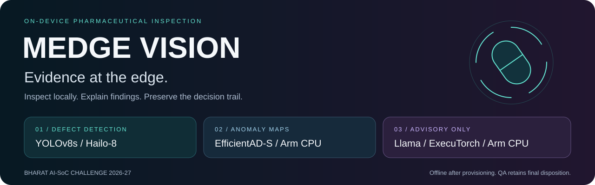
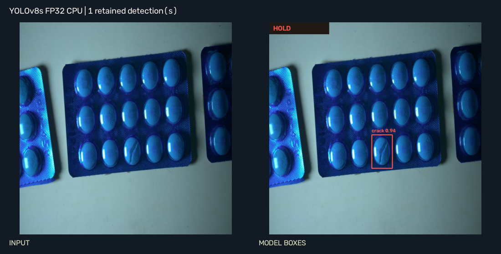
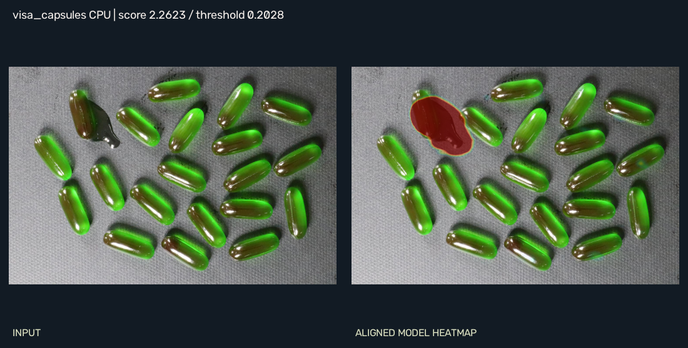
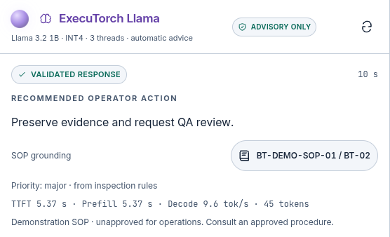

# Medge Vision

An offline inspection station for pharmaceutical blister packs on Raspberry Pi 5. Hailo-8 finds known defects, Arm CPU anomaly models highlight unusual appearances, and ExecuTorch Llama explains recorded findings while QA retains the verdict.

Built for the **Bharat AI-SoC Challenge 2026–27 (PS5)** by Haridharan D (team lead), Priyadharsan D and Jayaraj M.

**[Final report for judging (PDF)](docs/Medge_Vision_Final_Report_for_Judging.pdf)** · [Judges' guide](JUDGES_START_HERE.md) · [Run it](QUICKSTART.md) · [Full results](docs/RESULTS.md)

## See the models run

| YOLOv8s crack detection | MVTec pill heatmap |
| :---: | :---: |
| [](evidence/judging/yolo_crack_boxes.png) | [](evidence/judging/mvtec_pill_heatmap.png) |
| Crack confidence **93.53%** | Score **0.6374**, threshold **0.3501** |
| **MVTec capsule heatmap** | **VisA capsules heatmap** |
| [](evidence/judging/mvtec_capsule_heatmap.png) | [](evidence/judging/visa_capsules_heatmap.png) |
| Score **3.6375**, threshold **0.2683** | Score **2.2623**, threshold **0.2028** |

Fresh CPU inference on selected examples using the shipped ONNX models. VisA remains a research profile with **24% held-out recall**. [Inference receipt](evidence/judging/inference_receipt.json) · [All examples and plots](evidence/judging/README.md)

### ExecuTorch Llama proof

[](evidence/judging/llama_advisory_proof.png)

Advisory panel cropped from the recorded Pi crack case. Llama returned “Preserve evidence and request QA review” and cited demo SOP clause **BT-02**. [Original target record](evidence/target_20261124/eight_test_report.json)

## What it does

- **Inspect stored images or USB/CSI camera captures.** YOLOv8s marks seven defect classes. Three EfficientAD-S profiles produce category-specific scores and heatmaps.
- **Record the verdict before asking Llama.** Advisory runs asynchronously against the recorded findings and demo SOP. It cannot alter the verdict.
- **Keep a traceable QA record.** Images, model and configuration hashes, and append-only reviews stay tied to the inspection ID. Use the dashboard, verdict-only display or terminal tools.

## Engineering scorecard

The target station uses a **Raspberry Pi 5 (BCM2712, Cortex-A76, aarch64 Debian Trixie)** and a **Hailo-8** accelerator. The measurements below cover four separate checks: labeled holdouts, repeated-image backend timing, advisory replay and selected station demonstrations.

| Pipeline / parameter | Recorded result | How it was measured |
| --- | --- | --- |
| **Inspection quality** · YOLOv8s, 7 classes, 640 × 640 input | **89.19% mAP50–95** · **99.22% mAP50** · **97.63% micro F1** at the fixed operating point | FP32 holdout, 1,303 images and 2,956 boxes. Class thresholds **0.86–0.91**. |
| **Image anomaly** · EfficientAD-S, 3 profiles, 256 × 256 input | Image AUROC / F1: **0.9834 / 92.37%** pill · **0.9485 / 88.32%** capsule · **0.6502 / 38.40%** VisA | Separate held-out category sets. Image thresholds **0.350053 / 0.268284 / 0.202819**. |
| **Anomaly localization** · mask evaluation | AUPRO **0.9557 / 0.8308 / 0.6985** for pill / capsule / VisA | Per-region overlap integrated up to pixel FPR 0.30. |
| **Edge latency** · ONNX CPU → Hailo-8 | **580.115 → 15.197 ms** mean (**38.17×** ratio), **15.526 ms** Hailo p95 | Pi detector path on repeated stored images. **35 CPU calls / 3,948 Hailo calls**. |
| **Deployment footprint** · FP32 ONNX → INT8 HEF | **44.74 → 10.11 MB** (**77.41% smaller**) | Standalone YOLO detector file sizes. Mean detector-process RSS in the separate runtime trial was **254.07 → 206.43 MiB**. |
| **Quantization check** · INT8 detection agreement | **37 matched · 2 INT8-only · 1 FP32-only** | 18 unannotated images, FP32 as reference. Labeled INT8 accuracy delta remains unmeasured. |
| **On-device advisory** · Llama 3.2 1B INT4, 3 default CPU threads | **15.156 → 8.071 s** median, **10.233 s** adaptive p95, **12.003 tokens/s** median decode | Baseline → adaptive-v1 on the same historical protocol. Final guard replay **26/39 → 36/39**. Prompt/output budgets **1,536 / 128 tokens**. |
| **Station demonstration** · recorded QA + fresh advisory | **8/8** expected visual outcomes · **8/8** fresh validated replies · **8.967 s** advisory median | Selected Pi cases with zero cache reuse. |

The Hailo timing excludes camera acquisition and advisory. Electrical power and long-shift endurance remain unmeasured. [Benchmark methods and raw evidence](docs/RESULTS.md) · [Frozen model parameters](docs/MODEL_CARDS.md) · [AutoVI benchmark context](docs/AUTOVI_COMPARISON.md)

## Run it

From a clone with a Python 3.11 virtual environment active, run CPU vision on Windows or Linux.

```sh
python -m pip install -r requirements.txt pytest httpx
python tools/verify_repository_artifacts.py
python tools/configure_station.py --backend onnx
python main.py --desktop
```

Open **http://127.0.0.1:8765/**. The verifier checks the included vision files and prepares the bundled Arm advisory runtime. The Pi uses the bundled Hailo-8 HEF and separately provisioned Llama artifacts. [Model files](models/README.md) · [Full setup and Pi deployment](QUICKSTART.md)

## Architecture

[](docs/architecture.svg)

The teal path records vision results and the QA verdict. The violet path reads recorded findings and returns advisory text to the operator. [Static architecture and details](docs/architecture.svg) · [Training and conversion](docs/MODEL_LIFECYCLE.md)

## Validation and limits

- **100 regression tests passed** in the local software run. Earlier release checks include CPU model smoke tests, native JSON-boundary checks and verified portable restore. [Tests](tests/) · [CI workflow](.github/workflows/tests.yml) · [Acceptance report](SUBMISSION_REPORT.md)
- **Labeled INT8 accuracy change, healthy-only YOLO specificity and production-camera generalization remain unmeasured.** The 18-image FP32/INT8 experiment measures output agreement. [Quantization evidence and paired test procedure](docs/AUTOVI_COMPARISON.md)
- **VisA missed 76 of 100 anomalies** and remains a research profile. Advisory is informational, and authorized QA retains release authority. [Limitations](docs/SUBMISSION_LIMITATIONS.md)

[Documentation index and earlier reports](docs/README.md) · [Third-party terms](THIRD_PARTY_NOTICES.md)
