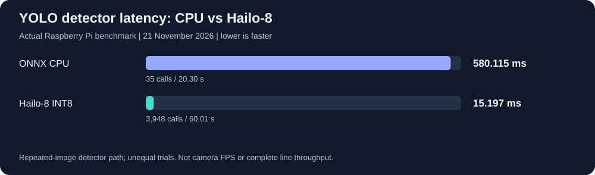
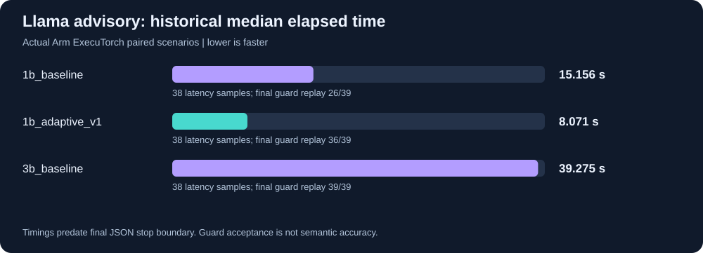

# Results and benchmark evidence

> Generated from preserved JSON and frozen contracts by `python tools/build_results_docs.py`. This page publishes existing measurements and explicitly labeled arithmetic; it does not rerun models. Run `python tools/build_results_docs.py --check` to verify it.

## Read the experiments separately

| Experiment | What it measures | Original evidence |
| --- | --- | --- |
| YOLO original labeled test | 1,303 images / 2,956 boxes; FP32 evaluator and separate fixed-threshold counts | [test_metrics.json](../evidence/historical/test_metrics.json) |
| Anomaly original labeled tests | Image decisions and mask-based localization for three category profiles | [METRICS.json / anomaly_historical](../evidence/historical/METRICS.json) |
| 21 Nov CPU / Hailo | Repeated-image detector latency/resources; unequal trial counts | [METRICS.json / hardware](../evidence/historical/METRICS.json) |
| FP32 / INT8 agreement | 18 unannotated reference-comparison images, not labeled accuracy | [METRICS.json / agreement](../evidence/historical/METRICS.json) |
| Historical Llama candidates | Paired scenario validation and instrumented latency; final guard replay separate | [BENCHMARKS.json / quality](../evidence/historical/BENCHMARKS.json) |
| 24 Nov complete station | Eight selected outcomes plus eight fresh on-device advisory responses | [eight_test_report.json](../evidence/target_20261124/eight_test_report.json) |

All rates in the tables below are percentages except AUROC/AUPR/AUPRO, which are fractions. CSV/JSON exports retain full precision. **None of the selected demo results is a population accuracy estimate.**

## 1. YOLOv8s: original FP32 held-out evaluator

Aggregate evaluator precision **99.46%**, recall **99.26%**, mAP50 **99.22%**, mAP50-95 **89.19%**. The stored evaluator Box-F1 values below are retained verbatim before display rounding. They do not describe the frozen deployment thresholds in the next table.

| Class | Images* | Instances | Precision | Recall | Box-F1 | mAP50 | mAP50-95 |
| --- | --- | --- | --- | --- | --- | --- | --- |
| black_dot | 235 | 511 | 99.49% | 99.22% | 99.35% | 99.50% | 89.95% |
| broken | 167 | 407 | 99.50% | 99.75% | 99.63% | 99.50% | 89.09% |
| color_mismatch | 218 | 420 | 99.90% | 100.00% | 99.95% | 99.50% | 89.77% |
| crack | 204 | 432 | 99.77% | 98.90% | 99.33% | 99.44% | 89.63% |
| dual_cap | 46 | 111 | 99.99% | 97.30% | 98.62% | 98.46% | 88.67% |
| empty | 238 | 634 | 98.23% | 99.84% | 99.03% | 98.86% | 88.59% |
| foreign_particle | 195 | 441 | 99.32% | 99.81% | 99.56% | 99.29% | 88.61% |

*A multi-class image can appear in more than one class count. Do not sum class image counts. The curated split excludes unresolved conflicts/invalid families and uses source-family/perceptual grouping; it is not the publisher benchmark and does not prove physical strip independence. **No normal-only images occur in this test. Healthy specificity and false-reject rate are not established.**

## 2. YOLO: fixed class-threshold operating point

Precision, recall and F2 are stored historical values. **F1 is derived** from the recorded TP/FP/FN. The micro row sums those counts before computing its rates; it is not the evaluator aggregate above. Thresholds are the unchanged [deployment values](../assets/thresholds.json), selected using validation rather than this table.

| Class | Threshold | TP | FP | FN | Precision | Recall | F1 (derived) | F2 |
| --- | --- | --- | --- | --- | --- | --- | --- | --- |
| black_dot | 0.9 | 502 | 12 | 9 | 97.67% | 98.24% | 97.95% | 98.12% |
| broken | 0.9 | 405 | 7 | 2 | 98.30% | 99.51% | 98.90% | 99.26% |
| color_mismatch | 0.89 | 413 | 9 | 7 | 97.87% | 98.33% | 98.10% | 98.24% |
| crack | 0.86 | 427 | 11 | 5 | 97.49% | 98.84% | 98.16% | 98.57% |
| dual_cap | 0.91 | 108 | 2 | 3 | 98.18% | 97.30% | 97.74% | 97.47% |
| empty | 0.91 | 603 | 14 | 31 | 97.73% | 95.11% | 96.40% | 95.62% |
| foreign_particle | 0.9 | 422 | 9 | 19 | 97.91% | 95.69% | 96.79% | 96.13% |
| micro_all | per-class | 2880 | 64 | 76 | 97.83% | 97.43% | 97.63% | 97.51% |

`Precision = TP/(TP+FP)`; `Recall = TP/(TP+FN)`; `F1 = 2TP/(2TP+FP+FN)`; `F2 = 5TP/(5TP+FP+4FN)`. Object matching and image decisions are different units. The historical image-level operating point recorded **6 false-pass images / 1,303 defective images (0.4605%)**. With zero healthy images, its healthy false-hold rate is undefined, not zero. [Download fixed-threshold CSV](../evidence/metrics/yolo_operating_point.csv).

## 3. EfficientAD-S: labeled image-level results

These are three independent normal-only trained category models, not EfficientNet and not seven-class YOLO. Each completed 70,000 FP32 steps with batch size 1. Checkpoint selection/map normalization and threshold calibration use separate normal subsets; test data are held out. Normal calibration quantile is 0.995. The scalar anomaly score is not a probability.

| Profile | Test / normal / defect | Precision | Recall | F1 | AUROC | AUPR | Accuracy | Normal FAR |
| --- | --- | --- | --- | --- | --- | --- | --- | --- |
| mvtec_pill | 167 / 26 / 141 | 100.00% | 85.82% | 92.37% | 0.9834 | 0.9970 | 88.02% | 0.00% |
| mvtec_capsule | 132 / 23 / 109 | 98.86% | 79.82% | 88.32% | 0.9485 | 0.9887 | 82.58% | 4.35% |
| visa_capsules | 160 / 60 / 100 | 96.00% | 24.00% | 38.40% | 0.6502 | 0.8010 | 51.88% | 1.67% |

| Profile | TN | FP | FN | TP | Image threshold | Specificity |
| --- | --- | --- | --- | --- | --- | --- |
| mvtec_pill | 26 | 0 | 20 | 121 | 0.350053 | 100.00% |
| mvtec_capsule | 22 | 1 | 22 | 87 | 0.268284 | 95.65% |
| visa_capsules | 59 | 1 | 76 | 24 | 0.202819 | 98.33% |

**Interpretation:** pill and capsule perform better than VisA at their saved operating points. VisA misses 76 of 100 anomalous test images (recall 24%); it remains a weak research/demo profile. High pixel AUROC does not repair its poor image-level recall. A 0/26 observed false-alarm count for pill does not prove zero future false alarms. No selected demo image was used to tune these thresholds.

## 4. Anomaly localization: mask-based results

| Profile | Annotated images | Pixel AUROC | Pixel F1 / Dice | AUPRO (FPR <= 0.3) |
| --- | --- | --- | --- | --- |
| mvtec_pill | 167 | 0.9849 | 69.26% | 0.9557 |
| mvtec_capsule | 132 | 0.9588 | 40.29% | 0.8308 |
| visa_capsules | 160 | 0.9779 | 37.08% | 0.6985 |

AUPRO uses 200 threshold steps and maximum false-positive rate 0.3. Pixel F1/Dice compares foreground masks, not image classification or bounding-box mAP. Raw pixel TN/FP/FN/TP are in [anomaly_pixel.csv](../evidence/metrics/anomaly_pixel.csv).

## 5. Actual Pi detector benchmark: CPU versus Hailo-8

21 November 2026. Same unannotated training-source demonstration images, repeated for timing. CPU and Hailo trials have different sample counts/durations. No camera was available for this experiment. **This is detector-path performance, not live-camera FPS, full inspection+Llama throughput, or production-line capacity.**

| Backend | Calls | Duration (s) | Mean (ms) | P95 (ms) | P99 (ms) | Calls/s | Mean CPU* | Mean RSS (MiB) | Mean temp (C) |
| --- | --- | --- | --- | --- | --- | --- | --- | --- | --- |
| onnx | 35 | 20.304 | 580.115 | 580.855 | 588.748 | 1.724 | 48.99% | 254.07 | 48.41 |
| hailo | 3948 | 60.010 | 15.197 | 15.526 | 15.635 | 65.789 | 10.85% | 206.43 | 41.47 |

Mean-latency ratio: **38.17x** (CPU mean / Hailo mean). *CPU percentages retain the original sampler convention; do not compare them directly with the process-tree CPU sums in the final station test. [Machine-readable comparison](../evidence/metrics/cpu_vs_hailo.csv).

## 6. Quantization and export: what was verified

| Check | Recorded outcome | Status |
| --- | --- | --- |
| FP32 export | Eight validation images; raw output [1,11,8400]; opset 11; maximum recorded absolute difference 0.003753662109375 | PASS: raw-tensor parity check |
| Hailo-8 deployment | Frozen INT8 HEF actually loaded and executed on HailoRT | PASS: execution |
| Reference agreement | 18 images; 37 matched, 2 INT8-only, 1 FP32-only detections; agreement P 94.87%, R 97.37% | Measured model agreement only |
| Labeled FP32 versus INT8 accuracy delta | Same labeled held-out dataset was not evaluated on both backends | NOT TESTED |

The raw tensor difference is not an accuracy drop. Reference-agreement precision/recall is not ground-truth defect precision/recall. No post-quantization mAP, F1 or accuracy prediction is substituted. [Export record](../evidence/historical/export_status.json); [compilation/preprocessing methodology](MODEL_LIFECYCLE.md).

## 7. ExecuTorch Llama: candidate and prompt comparison

Historical paired 50-scenario experiment: 39 bounded advisory inputs and 11 invalid inputs. Elapsed/TTFT summaries contain 38 timed samples and decode summaries 39; preserve those differing denominators. These timings predate the final native first-JSON-object stop boundary. **Acceptance means schema/evidence/SOP guard acceptance, not human-judged recommendation accuracy or classification F1.**

| Candidate | Median (s) | P95 (s) | Median callback TTFT (s) | Median decode tokens/s | Peak RSS (MiB) | Experiment accepted | Final guard replay |
| --- | --- | --- | --- | --- | --- | --- | --- |
| 1b_baseline | 15.156 | 15.768 | 8.136 | 10.264 | Not measured | 26/39 | 26/39 |
| 1b_adaptive_v1 | 8.071 | 10.233 | 4.010 | 12.003 | 1,598.55 | 37/39 | 36/39 |
| 3b_baseline | 39.275 | 41.684 | 21.220 | 3.649 | 3,223.77 | 39/39 | 39/39 |

The baseline 1B RSS was not recorded; it is not zero. Adaptive-v1 final-guard replay accepted 36/39, rather than the experimental 37/39. Selection preserves the existing 1B SpinQuant INT4 EO8 artifact, three threads, 128-token output limit and 1,536-token prompt budget under a 2,048-token exported context. Persistent workers, bounded queue/cache and JSON stopping reduce repeated work. Human semantic review remains incomplete. [Full optimization notes](LLAMA_EXECUTORCH_OPTIMIZATION.md).

## 8. Complete station: actual 24 November execution

Raspberry Pi 5, Hailo-8 YOLO, Arm CPU anomaly/ExecuTorch advisory. Each of eight selected cases matched its expected visual outcome and produced a fresh `llama_validated` response; cache reuse was zero. **Selected demonstration cases are not an unbiased test set.** The stored QA decision is separate from the visual model check.

| Case | Pipeline / selected case | Visual | QA | Vision (ms) | Advice (ms) | Observation |
| --- | --- | --- | --- | --- | --- | --- |
| 1-1 | YOLO selected SAFE | SAFE | REVIEW | 36.98 | 11,727.8 | No configured defect |
| 1-2 | YOLO selected DEFECTIVE | DEFECTIVE | HOLD | 15.04 | 9,970.1 | crack 0.90241 |
| 2-1 | MVTec pill selected SAFE | SAFE | REVIEW | 2,086.81 | 7,551.8 | score 0.072969 / threshold 0.350053 |
| 2-2 | MVTec pill selected DEFECTIVE | DEFECTIVE | REVIEW | 1,321.32 | 8,828.1 | score 0.637408 / threshold 0.350053 |
| 3-1 | MVTec capsule selected SAFE | SAFE | REVIEW | 1,726.36 | 7,599.4 | score 0.048460 / threshold 0.268284 |
| 3-2 | MVTec capsule selected DEFECTIVE | DEFECTIVE | REVIEW | 1,327.58 | 9,105.7 | score 3.637529 / threshold 0.268284 |
| 4-1 | VisA capsules selected SAFE | SAFE | REVIEW | 1,736.21 | 8,221.1 | score 0.124001 / threshold 0.202819 |
| 4-2 | VisA capsules selected DEFECTIVE | DEFECTIVE | REVIEW | 1,410.25 | 9,830.6 | score 2.262270 / threshold 0.202819 |

Advisory median **8.9669 s**; range 7.5518-11.7278 s. Service-tree peak RSS **1977.06 MiB**; peak summed CPU **302.6%**, where 100% is one logical core. Shared pages can be counted more than once. Regression/dependency validation overlapped the run; these are observed demo timings, not an isolated optimal-performance comparison. The first request also includes worker startup in application elapsed time.

### Actual advisory outputs

These messages are copied from the measured records, not rewritten example recommendations. All use the unapproved demo SOP `BT-DEMO-SOP-01`; authorized QA retains disposition authority.

| Case | SOP clause | Action | Actual operator message |
| --- | --- | --- | --- |
| 1-1 | BT-03 | RECAPTURE_AND_REVIEW | Check camera alignment and lighting, recapture if needed, and request human review. |
| 1-2 | BT-02 | ISOLATE_AND_REINSPECT | Preserve evidence and request QA review. |
| 2-1 | BT-03 | RECAPTURE_AND_REVIEW | Preserve evidence and request human review. |
| 2-2 | BT-03 | RECAPTURE_AND_REVIEW | Check camera alignment and lighting, recapture if needed, and request human review. |
| 3-1 | BT-03 | RECAPTURE_AND_REVIEW | Preserve evidence and request human review. |
| 3-2 | BT-03 | RECAPTURE_AND_REVIEW | Check camera alignment and lighting, recapture if needed, and request human review. |
| 4-1 | BT-03 | RECAPTURE_AND_REVIEW | Preserve evidence and request human review. |
| 4-2 | BT-03 | RECAPTURE_AND_REVIEW | Check camera alignment and lighting, recapture if needed, and request human review. |

The [original JSON](../evidence/target_20261124/eight_test_report.json) also preserves each inspection ID, bounding boxes, hashes, prompt/generated token counts, callback TTFT, raw response, validation trace and QA note. See [target_advisory_outputs.csv](../evidence/metrics/target_advisory_outputs.csv) and the [47-image actual Pi screenshot gallery](../evidence/gallery/README.md). Terminal screenshots are explicitly labeled replay of recorded outputs, not a second inference run.

## 9. Measurement and reproduction map

| Task | Entry point | Prerequisites / boundary |
| --- | --- | --- |
| Original YOLO training/evaluation | [Notebook and helper](../reproduction/yolo) | Original dataset, split and licensed training environment; not needed for inference |
| Original anomaly training | [Three independent notebooks](../reproduction/anomaly/notebooks) | Publisher datasets; full training separate from selected demo tests |
| Anomaly ONNX export | [export_deployment.py](../reproduction/anomaly/export_deployment.py) | Final checkpoints and normalization/threshold metadata |
| Hailo compilation | [compile_hef.sh](../reproduction/hailo/compile_hef.sh) | Licensed Linux x86-64 DFC; original training-only calibration data; included HEF avoids recompilation |
| New frozen-threshold labeled comparison | [evaluate_labeled.py](../tools/evaluate_labeled.py) | Explicit labels for every image; empty label = normal; one Hailo owner; not an mAP sweep |
| Native thread/load timing | [benchmark_native_matrix.py](../tools/benchmark_native_matrix.py) | Actual native runtime/model; fixed workload and sampling protocol |
| Paired advisory guard evaluation | [evaluate_quality_50.py](../tools/evaluate_quality_50.py) | Actual runtime and scenarios; automated guard checks are not semantic review |
| Eight-case service demonstration | [medge_eight_demo.py](../tools/medge_eight_demo.py) | Running service; selected examples; writes fresh IDs and outputs |
| CPU model smoke | [smoke_models.py](../tools/smoke_models.py) | Five selected cases; CPU only; not Hailo or Llama validation |
| Regenerate this evidence view | [build_results_docs.py](../tools/build_results_docs.py) | Python standard library; reads saved evidence only |

## 10. Downloads, integrity and missing measurements

Browse [all derived CSVs and JSON](../evidence/metrics). Every CSV row links to its original source path and JSON pointer. The JSON summary hashes each source file and records derivation formulas. Original evidence is never overwritten. The [source ledger](EVIDENCE_GUIDE.md) explains experiment scopes and provides exact reproduction commands.

NOT TESTED: labeled INT8 accuracy delta, healthy-only YOLO specificity, approved-SOP/human semantic advisory quality, new-product/camera generalization, power/energy, NPU utilization and eight-hour line endurance. Historical benchmarks, current selected tests and CI are distinct evidence classes.
