# Offline system architecture

Two independent runtimes remain explicit: seven-class YOLOv8s on Hailo-8/HailoRT; Llama3.2 Instruct SpinQuant in a native ExecuTorch process on Arm CPU. EfficientAD-S is a separate auxiliary ONNX CPU pipeline. No cloud services are required after installation.

```mermaid
flowchart LR
 U[USB camera / upload / local image] --> P[Frozen RGB letterbox and preprocessing]
 P --> N[Hailo-8: frozen HEF]
 N --> V[Frozen class thresholds and NMS]
 V --> D[Deterministic HOLD / REVIEW / PASS]
 D --> E[Original + annotated evidence, SHA-256, config identity]
 E --> DB[(SQLite WAL: batches, inspections, QA, audit)]
 DB --> UI[Offline inspection A/B and operations dashboard]
 E --> Q[Bounded asynchronous advisory queue]
 KB[Unapproved local demo SOP, versioned retrieval] --> Q
 Q --> L[ExecuTorch native Llama / Arm CPU]
 L --> J[Strict schema and bounded claim validation]
 J --> A[Informational advice or explicit fallback]
 A --> DB
 DB --> H[Append-only human QA action]
```

The advisory process never returns a replacement disposition to the deterministic engine. UI observation labels and QA disposition remain separate. `NO_VISIBLE_DEFECT_DETECTED` is a visual observation, not pharmaceutical safety certification. Unknown anomalies require warning/review; an absent Hailo runtime yields system fault, never an automatic acceptable product decision.

`main.py` owns CLI/desktop/server startup and loopback binding. FastAPI initialization is asynchronous. `InspectionService` preserves frozen detection behavior, saves evidence, commits/spools records and enqueues advisory work. Persistent Llama workers load once per lifecycle; independent requests reset KV state. Partial cache reuse between unrelated inspections is deliberately excluded.

Native C++ does not need full PyTorch at inference time. The build environment may retain PyTorch/torchgen; it is not imported by the production Llama worker. Native runtime + `libllama_runner.so` must be copied together. Source, artifacts, tokenizer, export recipe, compiler/runtime hashes and graph metadata provide a reproducible boundary.

The existing modern dashboard, classic dashboard and preserved original remain available. `/operations` adds real batches, reports, full audit verification, health and account access without replacing the working viewers. All fonts/icons/scripts are local. No CSI work is part of this release; USB verification is recorded separately.
