# Actual Pi evidence gallery

24 November 2026. Browser screenshots were captured from the actual Pi Chromium instance at native 1600 x 900. The terminal screenshots show the original measured run replayed in the physical Pi terminal, explicitly labelled on-screen. No results, confidence, advice or timings were edited. Loading archived results is not fresh inference.

## Entry and independent pipelines

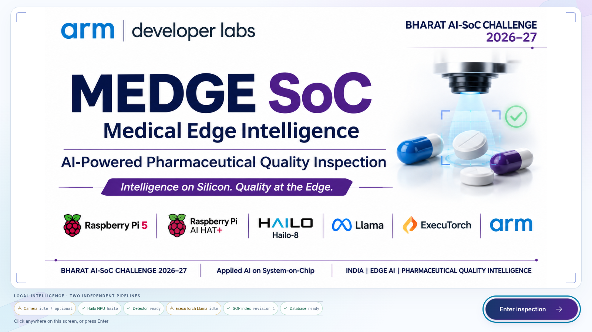

## 1. YOLO Hailo-8: SAFE

Inspection `8cfa5fe51aa5476a9dc14571f2f01cd6`. Actual vision 36.98 ms; Llama 11727.8 ms, llama_validated, no cache reuse. QA disposition remains REVIEW.

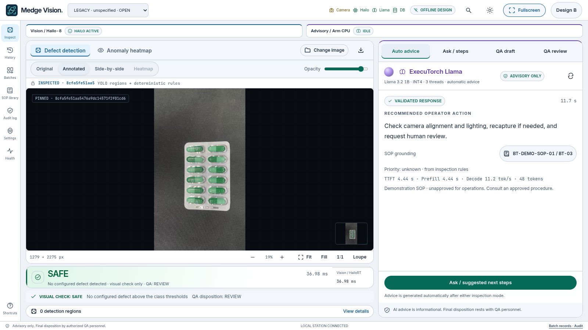

[Lower advisory panel](dashboard/01_yolo_safe_advice_bottom.png)

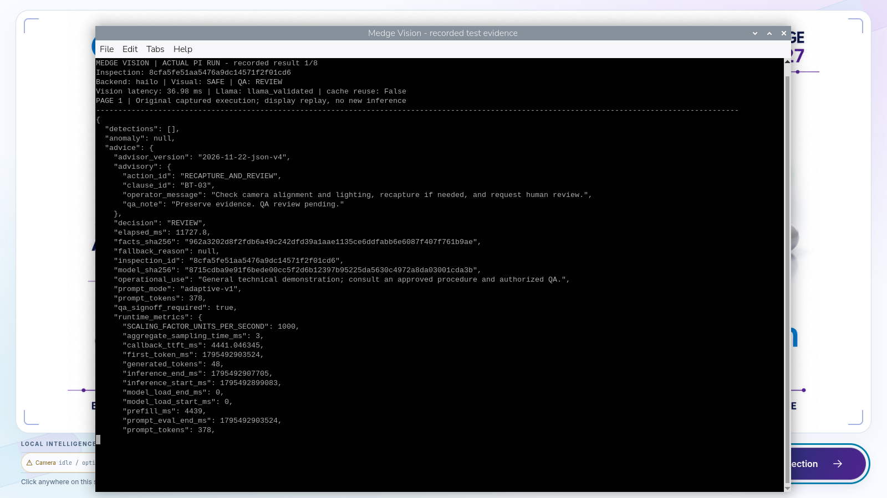

[Terminal full advisory page 2](terminal/terminal_case_01_02.png) · [Terminal metrics page 3](terminal/terminal_case_01_03.png)

## 2. YOLO Hailo-8: DEFECTIVE

Inspection `cf5cdda27c304cd9a47988165bc8fc99`. Actual vision 15.04 ms; Llama 9970.1 ms, llama_validated, no cache reuse. QA disposition remains HOLD.

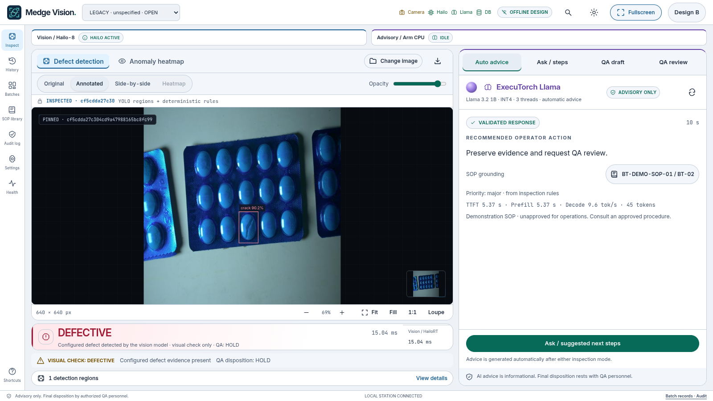

[Lower advisory panel](dashboard/02_yolo_defective_advice_bottom.png)

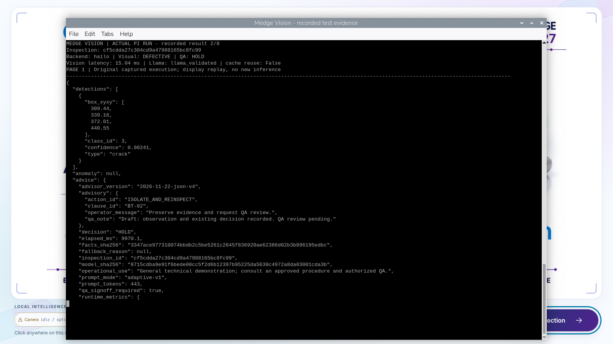

[Terminal full advisory page 2](terminal/terminal_case_02_02.png) · [Terminal metrics page 3](terminal/terminal_case_02_03.png)

## 3. mvtec_pill: SAFE

Inspection `d9f0249c6b4b489b8ab8a108c04f9a94`. Actual vision 2086.81 ms; Llama 7551.8 ms, llama_validated, no cache reuse. QA disposition remains REVIEW.

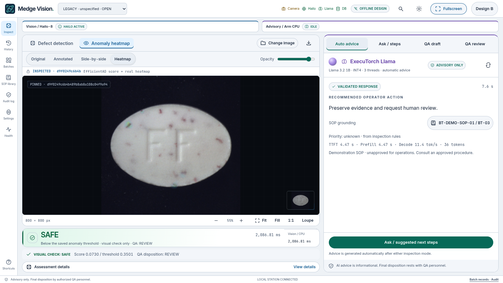

[Lower advisory panel](dashboard/03_anomaly_safe_advice_bottom.png)

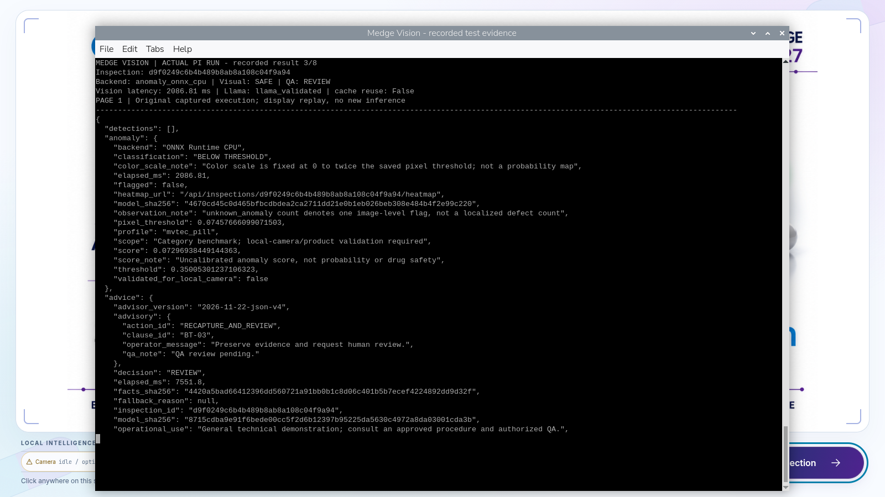

[Terminal full advisory page 2](terminal/terminal_case_03_02.png) · [Terminal metrics page 3](terminal/terminal_case_03_03.png)

## 4. mvtec_pill: DEFECTIVE

Inspection `91eace7edcf6408ebbe06ce70c2ec309`. Actual vision 1321.32 ms; Llama 8828.1 ms, llama_validated, no cache reuse. QA disposition remains REVIEW.

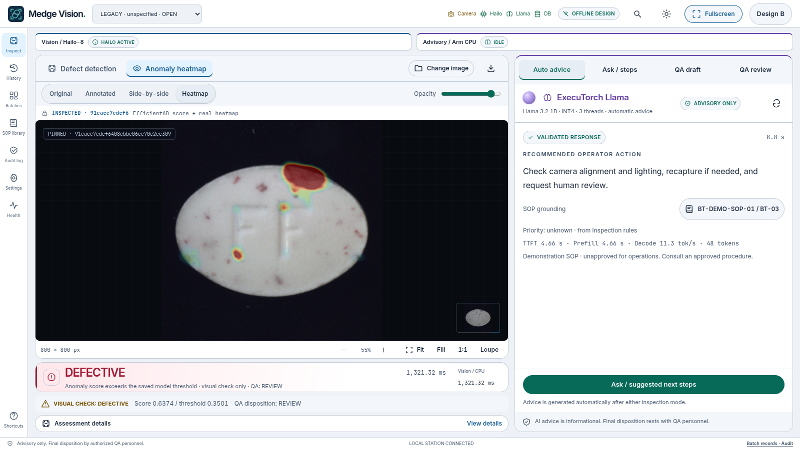

[Lower advisory panel](dashboard/04_anomaly_defective_advice_bottom.png)

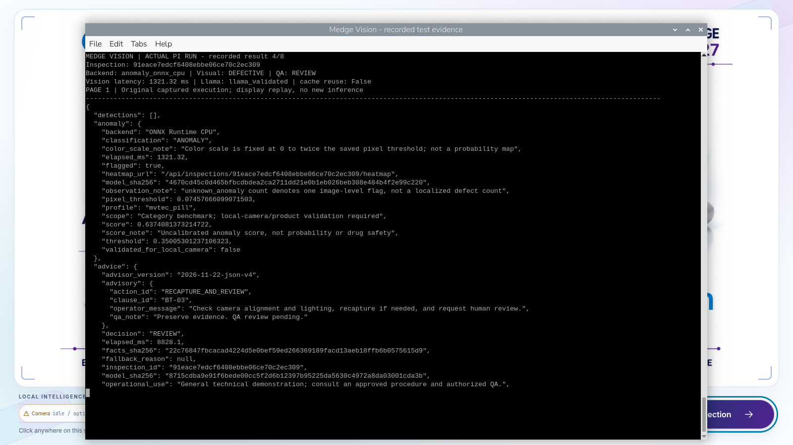

[Terminal full advisory page 2](terminal/terminal_case_04_02.png) · [Terminal metrics page 3](terminal/terminal_case_04_03.png)

## 5. mvtec_capsule: SAFE

Inspection `3b033dd2ba7d45918c516737afb35d30`. Actual vision 1726.36 ms; Llama 7599.4 ms, llama_validated, no cache reuse. QA disposition remains REVIEW.

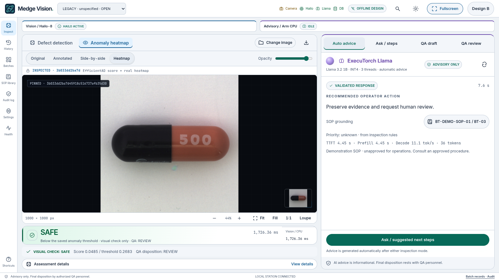

[Lower advisory panel](dashboard/05_anomaly_safe_advice_bottom.png)

[Terminal full advisory page 2](terminal/terminal_case_05_02.png) · [Terminal metrics page 3](terminal/terminal_case_05_03.png)

## 6. mvtec_capsule: DEFECTIVE

Inspection `3014b011b7d24476afc250269b3a67af`. Actual vision 1327.58 ms; Llama 9105.7 ms, llama_validated, no cache reuse. QA disposition remains REVIEW.

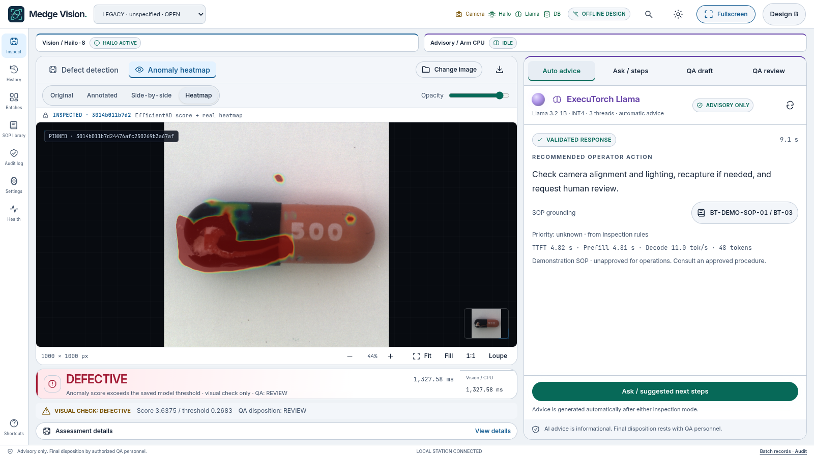

[Lower advisory panel](dashboard/06_anomaly_defective_advice_bottom.png)

[Terminal full advisory page 2](terminal/terminal_case_06_02.png) · [Terminal metrics page 3](terminal/terminal_case_06_03.png)

## 7. visa_capsules: SAFE

Inspection `535a14f89cf54198a8f6c03c20f03e82`. Actual vision 1736.21 ms; Llama 8221.1 ms, llama_validated, no cache reuse. QA disposition remains REVIEW.

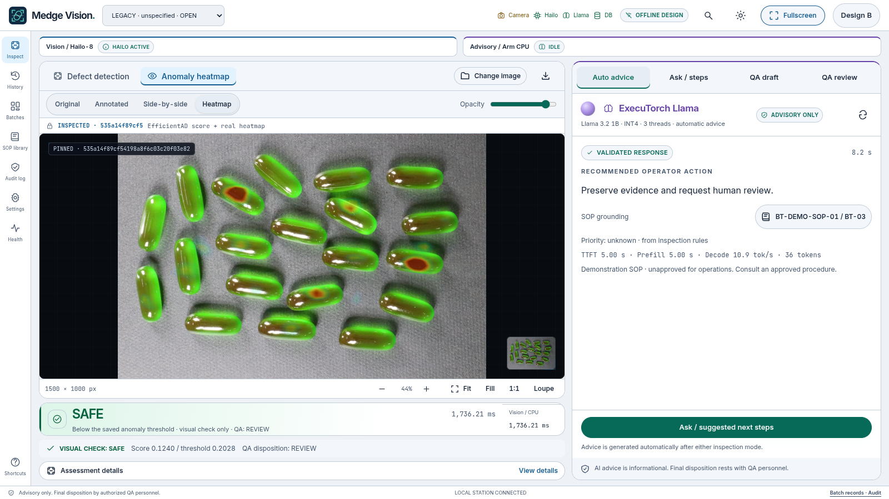

[Lower advisory panel](dashboard/07_anomaly_safe_advice_bottom.png)

[Terminal full advisory page 2](terminal/terminal_case_07_02.png) · [Terminal metrics page 3](terminal/terminal_case_07_03.png)

## 8. visa_capsules: DEFECTIVE

Inspection `7b9ab267a4c4469eb0137f4e7ca8318c`. Actual vision 1410.25 ms; Llama 9830.6 ms, llama_validated, no cache reuse. QA disposition remains REVIEW.

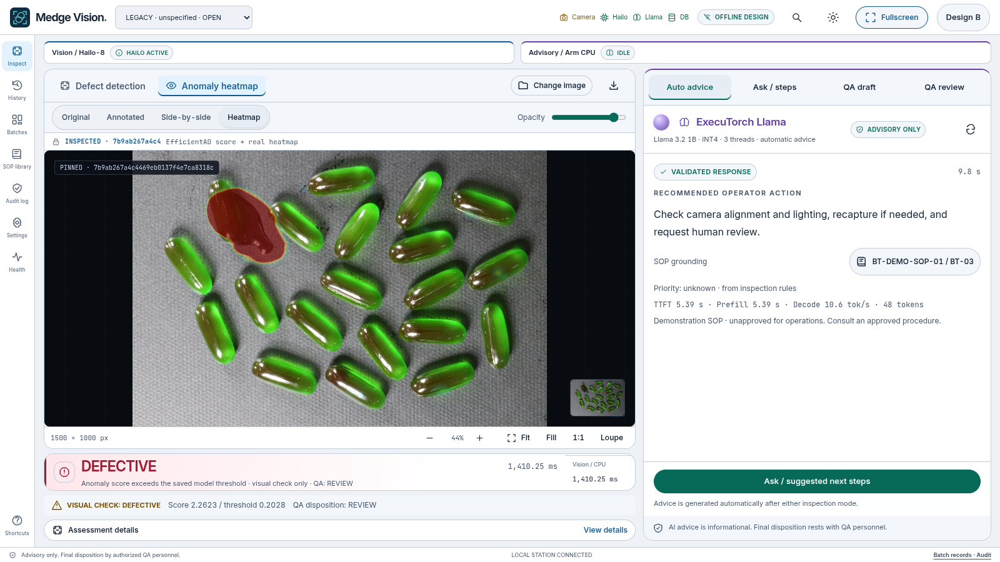

[Lower advisory panel](dashboard/08_anomaly_defective_advice_bottom.png)

[Terminal full advisory page 2](terminal/terminal_case_08_02.png) · [Terminal metrics page 3](terminal/terminal_case_08_03.png)

## Summary and other screens

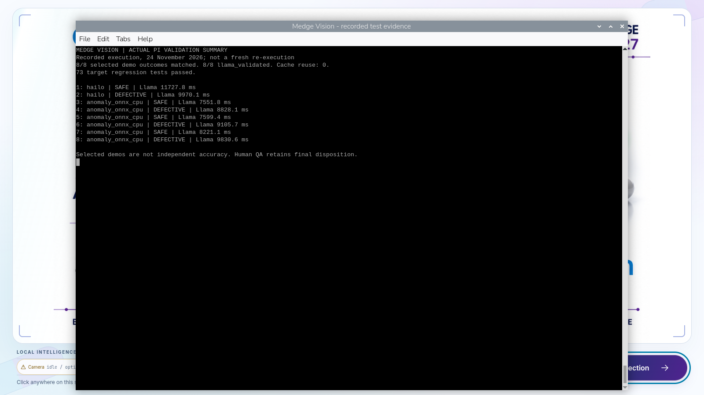

### History

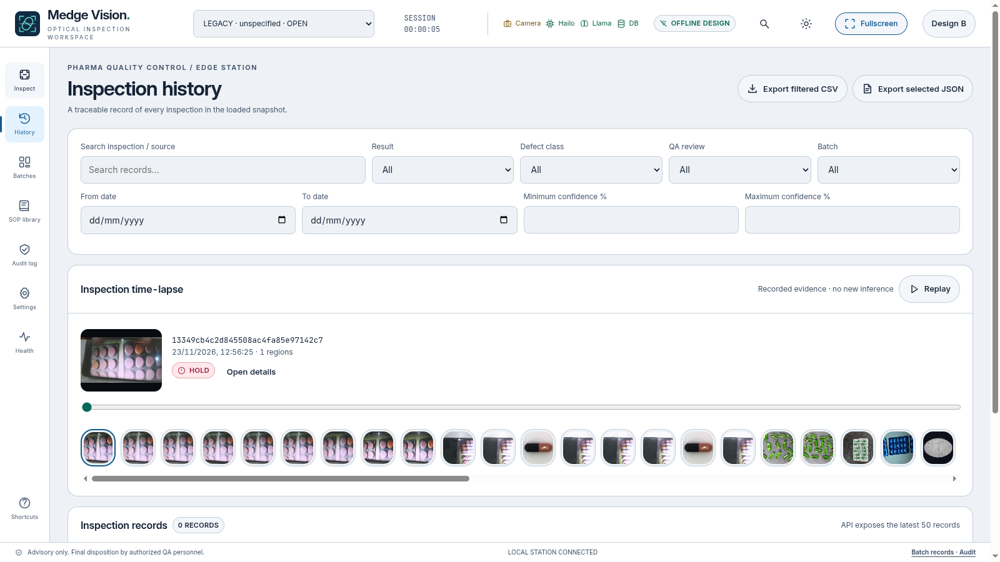

### Audit

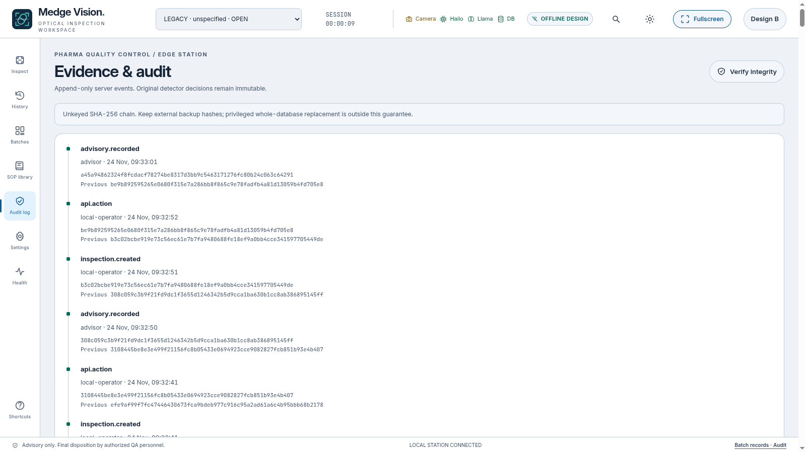

### Sop

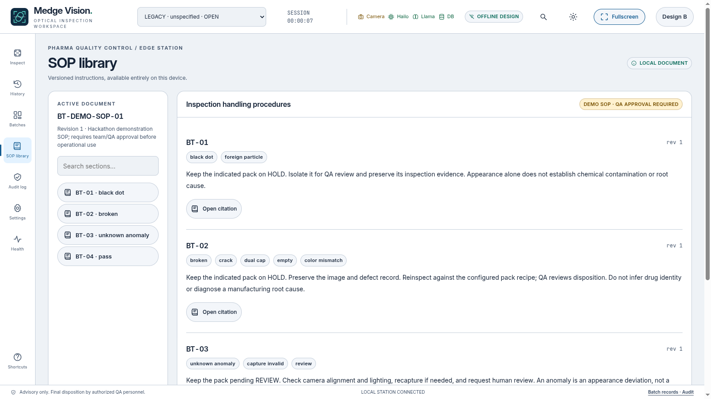

### Health

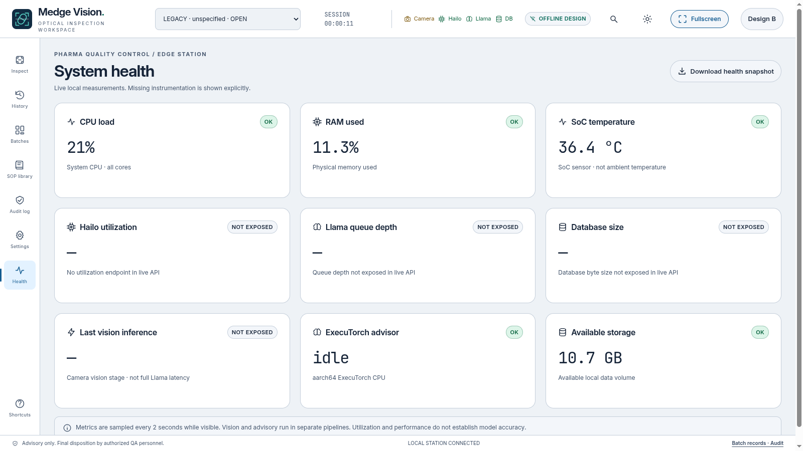

### Secondary display

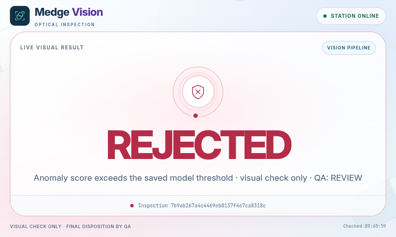

The second-display image shows the backend’s current pinned inspection, not each historical record selected in the main browser.

## Restore validation

The published demo bundle was restored into a new directory and loaded through the actual repository API. All eight record/image/original endpoints and six heatmap endpoints returned HTTP 200; original llama_validated advice was retained. See [API restore receipt](restored_api_verification.json).
